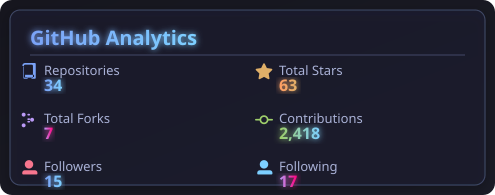
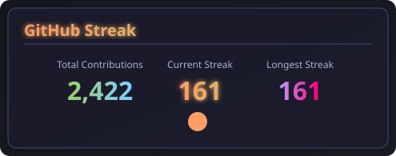
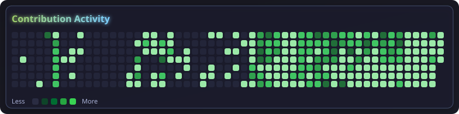

<h1 align="center">Weaver</h1>

  Software engineer working on distributed systems and protocol engineering. 
  Founder of <a href="https://spidroid.com">Spidroid Technologies</a>.

  
  

## Currently

- **Omnia Protocol**: a DAG-based Byzantine fault tolerant consensus system, written in Rust.
- **Android and web products** under Spidroid, in Kotlin and TypeScript.

## Stack

## GitHub

  
  

  

  

  <picture>
    <source media="(prefers-color-scheme: dark)" srcset="https://github.com/Willow7737/Willow7737/blob/output/github-contribution-grid-snake-dark.svg?raw=true"/>
    
  </picture>

